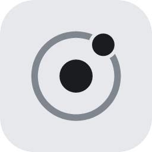
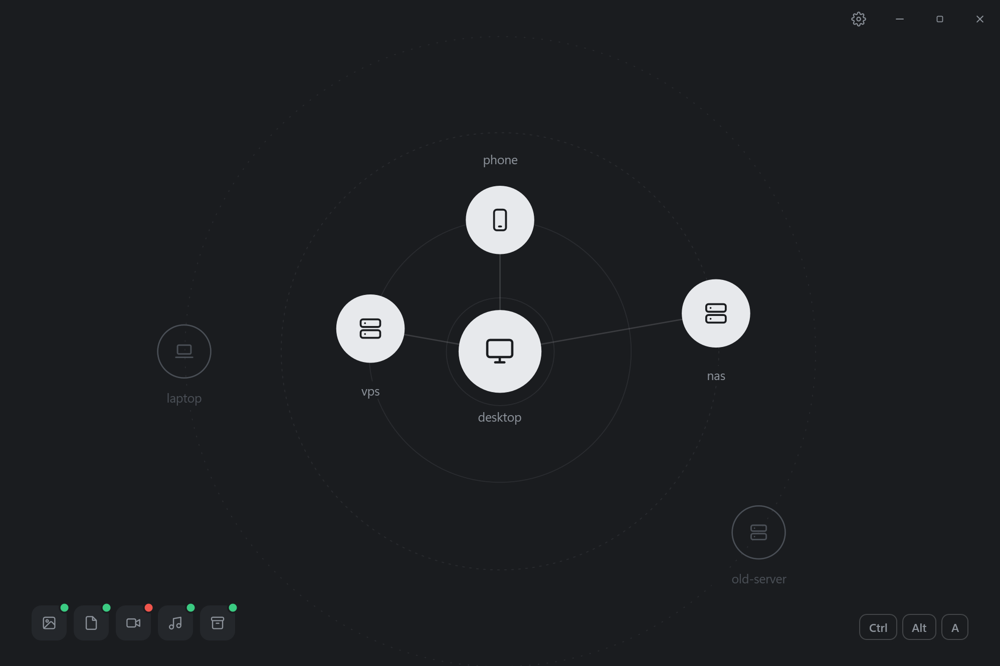
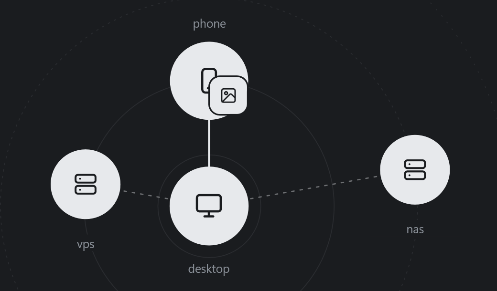
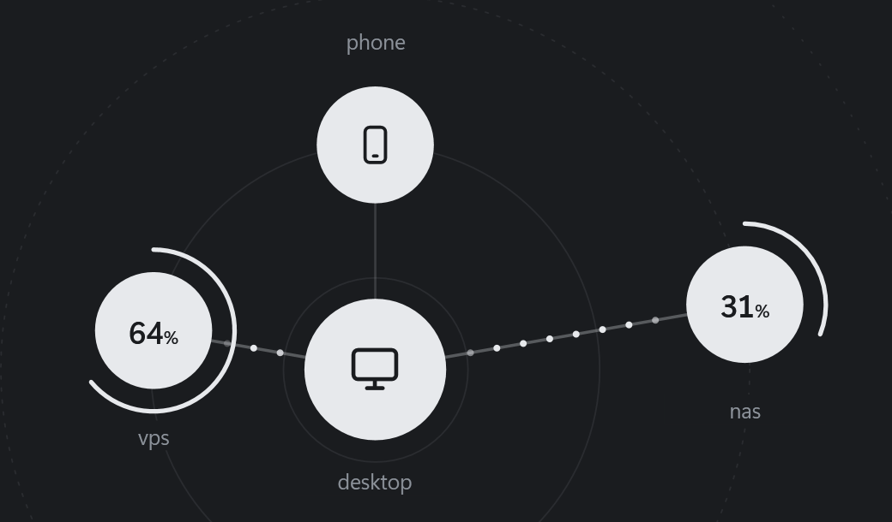
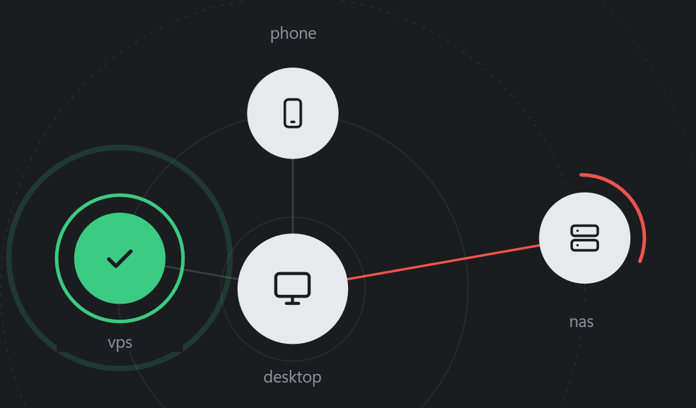
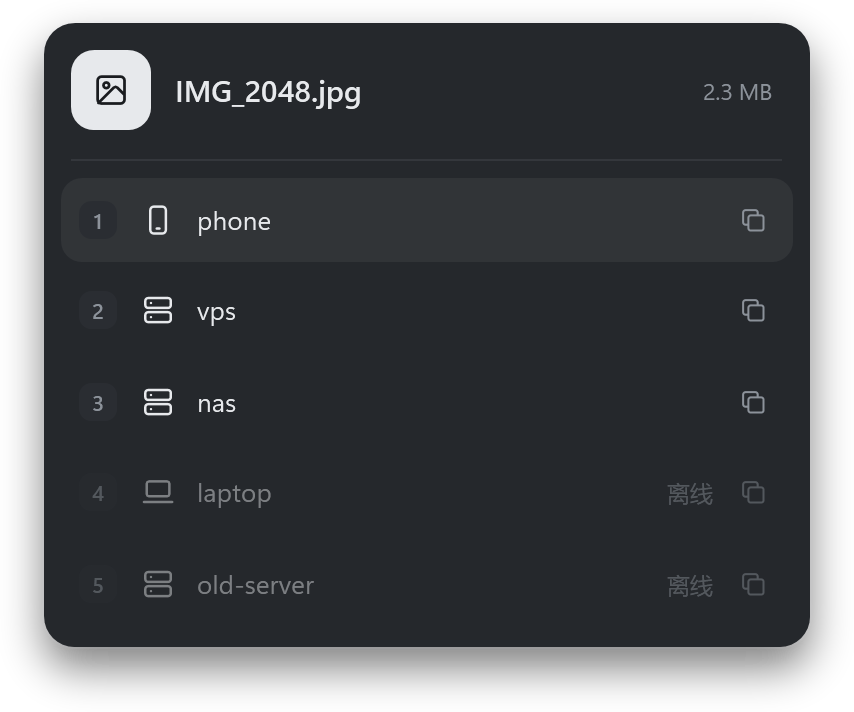

<p align="center"></p>

<h1 align="center">TailOrbit</h1>

<p align="center">
  把文件拖到设备上，用 Taildrop 发过去。<br>
  Drag a file onto a device to send it with Taildrop.
</p>

<p align="center"><a href="#中文">中文</a> · <a href="#english">English</a></p>

<p align="center"></p>

| 拖进来，对准 · Drag & aim | 发送中 · Sending | 送达 / 失败 · Delivered / Failed |
| :---: | :---: | :---: |
|  |  |  |

<p align="center"><br><sub>Ctrl+Alt+A 快捷面板 · quick panel</sub></p>

## 中文

TailOrbit 是配合 [Tailscale](https://tailscale.com) 用的一个 Windows 小工具。打开它，你的设备会围着这台电脑排成一张星图；把文件拖到哪台设备上，就用 Taildrop 发给哪台。

窗口顶上有五页：星网、分享、网络、云盘、本机，用 `Ctrl+1` 到 `Ctrl+5` 切换。

### 发文件、收文件

星图有三圈。里圈是直连的设备，中圈是走中继的（或者还没测出来），外圈是离线的，发不了。每次打开窗口，TailOrbit 会挨个 ping 一下在线的设备，测出是直连的会自己滑进里圈。

发文件有三种办法：

- 把文件拖进窗口，对准一台设备松手；
- 点一台设备，选「发文件」；
- 在资源管理器里选中文件，按 `Ctrl+Alt+A`，再按设备前面的数字键。

文件夹会先打成 zip 再发。发送时设备外面转一圈进度，鼠标移上去会出现 ×，点了就取消；送到了设备变绿打勾，失败了连线变红。

别人发文件过来时，光点会从那台设备流进中间。收好的文件出现在左下角，点一下就在资源管理器里找到它，拖到别的设备上还能接着发。

### 点一下设备

点一台设备，四周会弹出一圈按钮：开终端（用你在 `~/.ssh/config` 里给它起的别名）、发文件、复制域名、在浏览器里打开它的网页（它开着网页端口才有）、读它的剪贴板（只有 Mac 有），还有「掉线时提醒我」：打开后，它掉线和恢复时 Windows 都会弹个通知。

点设备的名字会复制它的 IP；点中间这台电脑会打开「下载」文件夹，Tailscale 收到的文件都放在那里。关掉窗口只是缩回托盘。右键托盘图标是一个小菜单：「发文件」「收到的文件」（找到最近收到的那个）、「终端」（指着它列出能连的设备），两个剪贴板开关也在这里，最下面是「退出」。

### 剪贴板

「本机」页上有两个跟剪贴板有关的开关。

**剪贴板互通**是给手机用的。打开后会弹出一个二维码，用登录了 Tailscale 的手机扫一下，网页上就是这台电脑剪贴板里的字，点「复制」就拿到了；点「把我的剪贴板发过去」，手机上的字就到了电脑上。

嫌扫码麻烦，可以在 iPhone 的「快捷指令」里做两个，再到「设置 → 辅助功能 → 触控 → 轻点背面」里绑上：

- 拿电脑的：「获取 URL 内容」（网址就是二维码里那个，末尾加上 `raw`）→「拷贝至剪贴板」。电脑剪贴板里是图片时这个网址拿不到字，中间最好加一个「如果…有任何值」，不然会把手机剪贴板清空。
- 发给电脑：「获取剪贴板」→「文本」→「获取 URL 内容」，方法选 POST，请求体选「文件」，放进上一步的文本。

**和 Mac 共用剪贴板**是给 Mac 用的。打开后，这台电脑和 Mac 就像在用同一个剪贴板：在哪边复制，两边都能粘贴。文字和图片（比如截图）都传，复制文件不传；超过 32 MB 的图片也不传，会弹个通知，这种用「发文件」发。它用 `~/.ssh/config` 里 Mac 的别名连过去，所以 Mac 要打开「远程登录」，Mac 上不用装任何东西。开关旁边的小电脑亮着，说明连上了。Mac 合盖睡着时会断开，醒来后自动连回，中间复制过的东西会补过去。如果 iPhone 和 Mac 登录的是同一个 Apple 账号、也开着接力，iPhone 上复制的东西也会经 Mac 一起过来。

不想一直同步的话，也可以只在需要时按 `Win+Alt+V`，把 Mac 剪贴板里的字读到这台电脑上。

剪贴板只在你自己的设备之间走：只有登录同一个 Tailscale 账号的设备能读，不经过 Funnel，也不上互联网，内容不会存到硬盘上。密码也照样能传；在两台电脑之间传时它仍然标着是密码，不会进剪贴板历史。

### 其他几页

- **分享**：把文件或文件夹拖进来，会生成一个只有你自己的设备能打开的链接和二维码；需要的话可以公开到互联网 15 分钟、1 小时或 1 天，时间到了自动关。你用 `tailscale serve`、`funnel` 挂着的东西也都在这页，背后的程序停了会标红。
- **网络**：每台设备是直连还是中继、延迟多少、现在传得多快；右边是网络体检和需要处理的问题。
- **云盘**：就是 Tailscale 的 Taildrive。还没开通的话点「一键开通」，照提示在 Tailscale 后台生成一把令牌、点 Copy，TailOrbit 会替你在访问规则里加上需要的两条，用完马上把这把令牌作废。不想交出令牌也行，点「自己改规则」，要加的内容已经替你复制好了。开通以后，把文件夹拖进来就共享给了自己的其他设备，别的设备共享的文件夹也能直接打开。
- **本机**：这台电脑在 Tailscale 里的名字、地址和账号，出口节点和常用开关，还有开机自启、上面说的两个剪贴板开关和界面语言。

### 安装

需要 Windows 10（1903 或更新）或 Windows 11，并且装好、登录了 Tailscale。用的是系统自带的 .NET Framework 4.8，不用另装运行库。

仓库里没有现成的 exe，拿 Windows 自带的编译器编一下就行，不用装 Visual Studio：

```powershell
git clone https://github.com/TinSB/TailOrbit.git
cd TailOrbit
powershell -ExecutionPolicy Bypass -File .\build.ps1
.\TailOrbit.exe
```

用 `TailOrbit.exe --tray` 启动就只待在托盘里，开机自启就是这么启动的。程序同时只会开一个，再运行一次只会把已经开着的窗口叫到前面。

### 隐私

TailOrbit 自己不连任何外部服务器，能交给 Tailscale 命令行做的都交给它。唯一的例外是云盘的「一键开通」：那一次会拿你给的令牌访问 Tailscale 官方的后台接口。

收发记录、分享列表和设置都只存在这台电脑的 `%LOCALAPPDATA%\TailOrbit\` 里，不会上传，剪贴板的内容也不记录。

<details>
<summary>具体调了哪些命令</summary>

| 做什么 | 怎么做 |
| --- | --- |
| 列出能收文件的设备 | `tailscale file cp --targets`、`tailscale status --json` |
| 判断直连还是中继 | `tailscale ping` |
| 发文件、看收发进度 | `tailscale file cp`；进度来自 `tailscale debug watch-ipn` |
| 分享 | `tailscale serve`、`tailscale funnel`；文件由 TailOrbit 在 `127.0.0.1` 上开的小服务提供，Tailscale 只负责转发 |
| 网络体检、流量 | `tailscale netcheck`、`tailscale metrics print` |
| 云盘 | `tailscale drive`；别的设备的共享通过 Tailscale 自带的 WebDAV（`100.100.100.100:8080`）读 |
| 一键开通云盘 | 用你的令牌读出访问规则，只加两条，写回前确认这期间没人改过，最后把令牌作废 |
| 本机设置 | `tailscale get`、`tailscale set` |
| 剪贴板互通 | `tailscale serve` 把 7443 端口上一个带随机码的地址转给本机的小服务，只放行你自己账号的设备 |
| 读 Mac、和 Mac 共用剪贴板 | 经 `ssh` 在 Mac 上跑 `pbpaste` 和一个小脚本；Windows 这边靠系统发来的“剪贴板变了”的通知。两边写进去时都带个记号，不会来回打转 |
| 设备菜单里的「网页」 | 设备在线时先试连几个常见的网页端口，菜单一打开就知道有没有 |
| 给桌面小组件用的本机接口 | 只听 `127.0.0.1:46214`，每次启动换一把随机令牌，存在 `%LOCALAPPDATA%\TailOrbit\island.json`；能列设备、发文件、看收发进度 |

</details>

### 其他

界面有简体中文、繁體中文、English、日本語、한국어、Deutsch、Français、Español 八种，默认跟着系统语言，在「本机」页可以换；分享出去的网页按访问者浏览器的语言显示。

这是个人项目，和 Tailscale 公司没有关系，也没有得到它的认可。Tailscale 和 Taildrop 是 Tailscale Inc. 的商标。代码用 [MIT 协议](LICENSE)；图标来自微软的 Fluent UI System Icons（同样是 MIT 协议），见 [THIRD-PARTY-NOTICES.md](THIRD-PARTY-NOTICES.md)。

## English

TailOrbit is a small Windows app for [Tailscale](https://tailscale.com). It lays your devices out as a star map around this PC. Drag a file onto a device and it goes there over Taildrop.

The window has five pages along the top: Orbit, Share, Network, Drive and This PC. `Ctrl+1` to `Ctrl+5` switch between them.

### Sending and receiving

The map has three rings. Devices you reach directly sit on the inner ring, relayed ones (or ones not checked yet) on the middle ring, and offline ones on the outer ring, where nothing can be sent. Each time the window opens, TailOrbit pings the online devices once, and any that turn out to be direct slide into the inner ring.

There are three ways to send:

- drag files into the window and drop them on a device;
- click a device and choose **Send files**;
- select files in File Explorer, press `Ctrl+Alt+A`, then press the number shown next to a device.

Folders get zipped first. While a file is on its way, a progress ring runs around the device; hover it and click the × to cancel. The device turns green when the file arrives, and the line turns red if it fails.

When someone sends you a file, dots flow from their device into the middle. Received files show up at the bottom left: click one to find it in File Explorer, or drag it onto another device to pass it on.

### Clicking a device

Click a device and a ring of buttons pops out around it: open a terminal (with the alias you gave it in `~/.ssh/config`), send files, copy its DNS name, open its web page (only when it has a web port open), read its clipboard (Macs only), and **Alert me when offline**, which makes Windows notify you when that device drops off and when it comes back.

Click a device's name to copy its IP. Click this PC in the middle to open Downloads, where Tailscale puts the files you receive. Closing the window only hides it in the tray. Right-click the tray icon for a small menu: **Send files**, **Received files** (shows the last file you received), **Terminal** (point at it to pick a device), the two clipboard switches, and **Exit** at the bottom.

### Clipboard

The This PC page has two clipboard switches.

**Shared clipboard** is for your phone. Turn it on and a QR code pops up. Scan it with a phone signed in to Tailscale and you get a page showing this PC's clipboard: tap **Copy** to take it, or **Send my clipboard** to put the phone's text on the PC.

If scanning gets old, make two shortcuts in the iPhone's Shortcuts app and put them on Back Tap (Settings → Accessibility → Touch → Back Tap):

- Get the PC's clipboard: **Get Contents of URL** (the address from the QR code with `raw` added at the end) → **Copy to Clipboard**. When the PC's clipboard holds an image, that address has no text, so put an **If … has any value** in between, or your phone's clipboard gets wiped.
- Send to the PC: **Get Clipboard** → **Text** → **Get Contents of URL**, with Method set to POST and Request Body set to File, holding the text.

**Sync clipboard with Mac** is for your Mac. Turn it on and this PC and the Mac act like one clipboard: copy on either, paste on both. Text and images (screenshots, say) come across; copied files don't. Images over 32 MB are skipped with a notification; send those with **Send files**. It connects with the alias for your Mac in `~/.ssh/config`, so Remote Login needs to be on, and nothing is installed on the Mac. The little laptop next to the switch lights up while it's connected. When the Mac sleeps the link drops; when it wakes, TailOrbit reconnects and passes along anything copied in between. If your iPhone and Mac share an Apple Account with Handoff on, whatever you copy on the iPhone comes through the Mac too.

If you'd rather not sync all the time, press `Win+Alt+V` whenever you want to pull the Mac's clipboard onto this PC.

The clipboard only travels between your own devices: only devices signed in to your Tailscale account can read it, nothing goes through Funnel or the internet, and nothing is written to disk. Passwords come along too; between the two computers they stay marked as passwords, so they don't end up in clipboard history.

### The other pages

- **Share**: drop a file or folder here to get a link and QR code that only your devices can open. If you need to, make it public on the internet for 15 minutes, an hour or a day; it closes itself when time is up. Anything you already serve with `tailscale serve` or `funnel` shows up here too, and turns red if the program behind it has stopped.
- **Network**: whether each device is direct or relayed, its latency and how fast it's transferring right now, plus a network check-up and anything that needs fixing.
- **Drive**: Tailscale's Taildrive. If it isn't set up yet, click **Turn on Drive**, generate an access token in the Tailscale admin console when asked, and click Copy. TailOrbit adds the two entries Taildrive needs to your access rules and revokes the token right away. If you'd rather not hand over a token, choose **Edit access controls yourself**; the text to paste is already copied for you. Once it's on, drop a folder in to share it with your other devices, and open the folders they share.
- **This PC**: this computer's name, addresses and account on Tailscale, the exit node and common switches, plus **Start with Windows**, the two clipboard switches and the interface language.

### Install

You need Windows 10 (1903 or later) or Windows 11, with Tailscale installed and signed in. It runs on the .NET Framework 4.8 that comes with Windows, so there's nothing else to install.

There's no prebuilt exe. Build it with the compiler that ships with Windows; no Visual Studio needed:

```powershell
git clone https://github.com/TinSB/TailOrbit.git
cd TailOrbit
powershell -ExecutionPolicy Bypass -File .\build.ps1
.\TailOrbit.exe
```

Run `TailOrbit.exe --tray` to start in the tray only; that's how **Start with Windows** launches it. Only one copy runs at a time, and launching it again just brings the open window to the front.

### Privacy

TailOrbit doesn't talk to any outside server; it leaves everything it can to Tailscale's own command line. The one exception is the one-click Drive setup, which uses the token you give it to call Tailscale's admin API once.

Your history, shares and settings stay in `%LOCALAPPDATA%\TailOrbit\` on this PC and are never uploaded. Clipboard contents aren't recorded either.

<details>
<summary>What it runs under the hood</summary>

| What | How |
| --- | --- |
| List devices that can receive files | `tailscale file cp --targets`, `tailscale status --json` |
| Tell direct from relayed | `tailscale ping` |
| Send files and track progress | `tailscale file cp`; progress comes from `tailscale debug watch-ipn` |
| Share | `tailscale serve`, `tailscale funnel`; files are served by a small TailOrbit server on `127.0.0.1`, and Tailscale only forwards to it |
| Network check-up and traffic | `tailscale netcheck`, `tailscale metrics print` |
| Drive | `tailscale drive`; other devices' shares are read through Tailscale's built-in WebDAV (`100.100.100.100:8080`) |
| One-click Drive setup | reads your access rules with the token, adds two entries, checks that nobody changed them in the meantime before writing back, then revokes the token |
| This PC | `tailscale get`, `tailscale set` |
| Shared clipboard | `tailscale serve` forwards an address with a random code on port 7443 to the small local server, and only lets in devices on your own account |
| Reading the Mac, syncing with the Mac | runs `pbpaste` and a small script on the Mac over `ssh`; on Windows it listens for the system's "clipboard changed" notice. Both sides tag what they write, so nothing bounces back and forth |
| "Web" in the device menu | tries a few common web ports while the device is online, so the menu knows right away |
| Local API for desktop widgets | listens only on `127.0.0.1:46214`, with a new random token each launch saved in `%LOCALAPPDATA%\TailOrbit\island.json`; lists devices, sends files, streams transfer progress |

</details>

### Notes

The interface comes in Simplified Chinese, Traditional Chinese, English, Japanese, Korean, German, French and Spanish. It follows your Windows language and can be changed on the This PC page; shared web pages follow the visitor's browser language.

This is a personal project, not affiliated with or endorsed by Tailscale Inc. Tailscale and Taildrop are trademarks of Tailscale Inc. The code is under the [MIT License](LICENSE); the icons are Microsoft's Fluent UI System Icons (also MIT), see [THIRD-PARTY-NOTICES.md](THIRD-PARTY-NOTICES.md).
